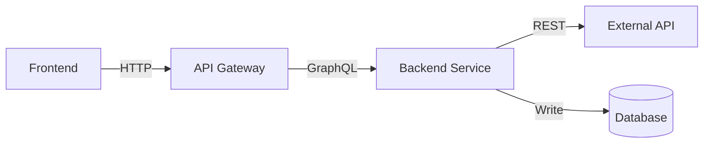

### 5. Technical Solution (MANDATORY)

````markdown
## Technical Solution

### Architecture Overview

[High-level description of the solution]

**Key Components**:

- Component A: [responsibility]
- Component B: [responsibility]
- Component C: [responsibility]

**Architecture Diagram**:

[Include Mermaid diagram, PlantUML, or link to diagram]


````

### Data Flow

1. **Step 1**: User action → Frontend
2. **Step 2**: Frontend → API Gateway (POST /resource)
3. **Step 3**: API Gateway → Service Layer
4. **Step 4**: Service → External API (if applicable)
5. **Step 5**: Service → Database (persist)
6. **Step 6**: Response → Frontend

### APIs & Endpoints

| Endpoint               | Method | Description      | Request     | Response         |
| ---------------------- | ------ | ---------------- | ----------- | ---------------- |
| `/api/v1/resource`     | POST   | Creates resource | `CreateDto` | `ResourceDto`    |
| `/api/v1/resource/:id` | GET    | Get by ID        | -           | `ResourceDto`    |
| `/api/v1/resource/:id` | DELETE | Delete resource  | -           | `204 No Content` |

**Example Request/Response**:

```json
// POST /api/v1/resource
{
  "name": "Example",
  "type": "standard"
}

// Response 201 Created
{
  "id": "550e8400-e29b-41d4-a716-446655440000",
  "name": "Example",
  "type": "standard",
  "status": "active",
  "createdAt": "2026-02-04T10:00:00Z"
}
```

### Database Changes

**New Tables**:

- `{ModuleName}{EntityName}` - [description]
  - Primary fields: id, userId, name, status
  - Timestamps: createdAt, updatedAt
  - Indexes: userId, status (for query performance)

**Schema Changes** (if modifying existing):

- Add column `newField` to `ExistingTable`
  - Type: [varchar/integer/jsonb/etc.]
  - Constraints: [nullable/unique/foreign key]

**Migration Strategy**:

- Generate migration from schema changes
- Test migration on staging environment first
- Run during low-traffic window
- Have rollback migration ready

**Data Backfill** (if needed):

- Affected records: Estimate quantity
- Processing time: Estimate duration for data migration
- Validation: How to verify data integrity after backfill

````

**If user provides vague description**: Ask "What are the main components? How does data flow through the system? What APIs will be created/modified?"
